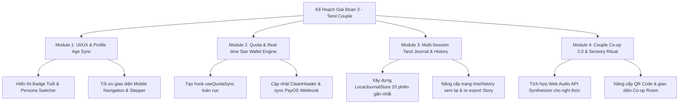

# 🔮 Kế Hoạch Nâng Cấp Giai Đoạn 3 (PLAN_GD3.md)
> **Dự án:** Tarot Couple — Nền tảng Bói Tarot AI Đa Nhân Vật & Bói Đôi  
> **Người thực hiện:** Multi-Agent Team (`team` skill: Leader, Critic/Reviewer, Design-Taste-Frontend, Coder, Tester, Guardrail & Safety)  
> **Phiên bản:** Phase 3 Master Specification & Implementation Roadmap  
> **Thời gian cập nhật:** 12/10/2026  
> **Trạng thái:** Sẵn sàng thực thi (Ready for Execution)

---

## 1. TỔNG QUAN AUDIT & REVIEW TOÀN DIỆN (SYSTEM AUDIT)

Sau khi kiểm toán toàn diện mã nguồn (`src/app`, `src/lib`, `src/components`, `src/data`, `api routes` và 50/50 vitest passed), nhóm Multi-Agent xác định sản phẩm đã có nền móng kiến trúc vững chắc (78 lá bài RWS 1909 chuẩn, 4 Reader persona, Zod runtime validation, safety guardrails, quota engine, Satori 1080x1920 Story Card renderer, AI fallback).

Tuy nhiên, đối chiếu với trải nghiệm thực tế của người dùng và tiêu chuẩn sản phẩm thương mại cao cấp, còn tồn tại **5 nhóm vấn đề cần giải quyết triệt để trong Giai đoạn 3 (GD3)**:

### 1.1. Vấn đề UI/UX & Nhận diện lứa tuổi (Age Policy & Persona UX)
* **Vấn đề đã phát hiện:** Người dùng người lớn khi trải bài lần đầu chọn chủ đề "Vận may ngày mới" bị chuyển sang giọng xưng "Bà Ngoại" do default tuổi hoặc chưa hiểu cơ chế an toàn 10–15 tuổi.
* **Cần cải tiến:** 
  1. Thêm chỉ báo lứa tuổi trực quan, huy hiệu chế độ (Adult Mode 🔥 vs Safe School Mode 🌸) ngay tại màn hình chọn chủ đề và lều Reader.
  2. Cho phép người dùng chuyển đổi nhanh chế độ xưng hô (nếu đủ 16+) ngay tại header hoặc màn hình hồ sơ mà không bị lúng túng.
  3. Bổ sung modal giải thích minh bạch vì sao có sự phân tầng Reader theo độ tuổi để tuân thủ Nghị định 13 và an toàn thanh thiếu niên.

### 1.2. Tính liên kết dữ liệu & Nhật ký trải bài (Tarot Journal Persistence)
* **Vấn đề đã phát hiện:** Trang `/me/history` (Nhật ký trải bài) hiện tại chỉ đọc `readingSuccess` từ Zustand store (bộ nhớ tạm), khi người dùng F5 hoặc có nhiều lượt trải bài thì các lượt cũ bị mất, chưa có danh sách lưu đa phiên (Local Journal History).
* **Cần cải tiến:** 
  1. Xây dựng `LocalJournalStore` đồng bộ `localStorage` lưu tối đa 20 phiên trải bài gần nhất kèm 3 lá bài, câu hỏi, luận giải và ngày giờ.
  2. Trang `/me/history` cho phép xem lại chi tiết từng lượt bói cũ, lọc theo Reader, lọc theo Chủ đề, và tải lại ảnh Story 9:16 bất cứ lúc nào.
  3. Bổ sung tính năng "Đánh dấu trải bài tâm đắc (Bookmark/Favorite)".

### 1.3. Đồng bộ số dư Sao & Quota thời gian thực trên toàn bộ ứng dụng
* **Vấn đề đã phát hiện:** Component [CleanHeader.tsx](file:///d:/MyProjects/MyProjectToMoney/TarotCouple/src/components/CleanHeader.tsx) và một số trang đang dùng giá trị mặc định tĩnh (`starsBalance = 15, remainingToday = 3`), chưa gắn kết trực tiếp với hook lấy quota động từ server `/api/reading`.
* **Cần cải tiến:**
  1. Tạo hook `useQuotaSync()` tập trung, tự động revalidate số dư Sao và lượt bốc bài sau mỗi lượt rút, nạp tiền PayOS, điểm danh streak hoặc chia sẻ nhận thưởng.
  2. [CleanHeader.tsx](file:///d:/MyProjects/MyProjectToMoney/TarotCouple/src/components/CleanHeader.tsx) hiển thị chính xác số dư thực tế kèm animation cộng Sao nhẹ nhàng khi nhận thưởng.

### 1.4. Tối ưu hóa Ritual & Hiệu ứng chuyển cảnh (Tactile Motion & Sound/Haptic)
* **Vấn đề đã phát hiện:** Luồng rút bài rẻ quạt [TactileArcFan.tsx](file:///d:/MyProjects/MyProjectToMoney/TarotCouple/src/components/TactileArcFan.tsx) đã mượt mà nhưng khi chạm vào lá bài chưa có âm thanh rung huyền bí (sound effects / ambient chime), hiệu ứng lật bài 3D ở màn hình kết quả cần thêm chiều sâu thị giác (Golden Sparkles & Cosmic Nebula Glow).
* **Cần cải tiến:**
  1. Tích hợp bộ âm thanh Web Audio API tổng hợp (ambient bell / card flip whisper / chime khi chọn trúng lá bài) hoàn toàn không tốn dung lượng tải file ngoài.
  2. Tăng cường hiệu ứng hạt sao và vệt sáng vàng kim khi lật mở từng lá bài (Reveal 1 $\rightarrow$ 2 $\rightarrow$ 3 $\rightarrow$ Chốt hạ).

### 1.5. Nâng cấp Bói Đôi (Couple Mode Co-op 2.0 & Room Sharing)
* **Vấn đề đã phát hiện:** Chế độ Bói Đôi (`/couple`) đã có backend tạo phòng 6 ký tự và solo check, nhưng giao diện mời bạn người B vào phòng cần được làm hấp dẫn hơn với QR Code quét nhanh từ camera điện thoại, thẻ bài 2 người lồng ghép năng lượng trực quan.
* **Cần cải tiến:**
  1. Hiển thị mã QR động dẫn thẳng tới link phòng `https://tarotcouple2007.vercel.app/couple?roomCode=XYZ`.
  2. Hiệu ứng "Chạm hai bàn tay / Đồng điệu nhịp tim" khi người B vào phòng và cùng rút lá thứ 3 (Sợi dây kết nối).
  3. Xuất ảnh Story 9:16 riêng biệt cho Bói Đôi với 2 nửa âm dương hòa hợp và thước đo Red Flag/Hợp Cạ nổi bật.

---

## 2. KIẾN TRÚC & PHÂN RÃ HẠNG MỤC GIAI ĐOẠN 3 (WORK BREAKDOWN STRUCTURE)

Kế hoạch GD3 được chia làm **4 Module lớn** với các tiêu chí nghiệm thu rõ ràng:



---

## 3. CHI TIẾT TỪNG MODULE THỰC THI

### MODULE 1: UI/UX, PROFILE & MINH BẠCH LỨA TUỔI (AGE POLICY TRANSPARENCY)
* **Mục tiêu:** Giải quyết triệt để tình trạng người dùng bối rối khi thấy xưng hô "Bà Ngoại" hoặc "Bà Cố", tăng cường tính linh hoạt trong hồ sơ người dùng.
* **Nhiệm vụ cụ thể:**
  1. Cập nhật `src/app/(reading)/reading/ve-ban/page.tsx`:
     * Thêm hiển thị visual thẻ Badge ngay khi chọn năm sinh:
       * Năm sinh $\le 2010$: Badge **"🔥 Chế độ Trưởng thành (16+) — Mở khóa Bà Cố Mỏ Hỗn, Tổng Tài Lý Trí, Pháp Sư Tối Cổ & Trọn bộ chủ đề"**.
       * Năm sinh $\ge 2011$: Badge **"🌸 Chế độ Học đường (10–15 tuổi) — Bà Ngoại Vui Tính, chủ đề trong sáng, bảo vệ trẻ em"**.
     * Thêm tooltip / modal giải thích thân thiện: *"Vì sao có sự phân tầng này? Chúng tôi tuân thủ quy chuẩn bảo vệ tinh thần thanh thiếu niên và an toàn ngôn ngữ."*
  2. Cập nhật `src/app/(reading)/reading/chu-de/page.tsx`:
     * Hiển thị rõ tên Reader đang đồng hành ở góc trên trang để người dùng luôn biết ai đang xem bài cho mình.
  3. Cập nhật `src/components/CleanHeader.tsx`:
     * Khi người dùng bấm vào Avatar hoặc Tên Reader ở header, hiển thị popover thông tin Reader và độ tuổi hiện tại.

---

### MODULE 2: ĐỒNG BỘ QUOTA & VÍ SAO THỜI GIAN THỰC (REAL-TIME STAR WALLET)
* **Mục tiêu:** Mọi thay đổi về Sao (nạp tiền, điểm danh +2, mời bạn +5, xem ad +3, rút bài lá thứ 4 -5 Sao, mở bộ bài 78 lá) được phản ánh tức thì trên toàn bộ các component.
* **Nhiệm vụ cụ thể:**
  1. Tạo `src/lib/use-quota.ts`:
     * Hook React SWR/Zustand quản lý client quota.
     * Cung cấp các hàm: `refreshQuota()`, `deductStars(amount)`, `addStars(amount)`, `useQuota()`.
     * Đồng bộ cookie `tc_client_key` để nhất quán giữa client và server API.
  2. Cập nhật [CleanHeader.tsx](file:///d:/MyProjects/MyProjectToMoney/TarotCouple/src/components/CleanHeader.tsx):
     * Nhận dữ liệu từ `useQuota()`.
     * Khi số dư thay đổi, kích hoạt micro-animation rung lắc ánh kim (glow shimmer) trên chip `⭐ {stars} Sao`.
  3. Cập nhật các Modal [WalletPayOSModal.tsx](file:///d:/MyProjects/MyProjectToMoney/TarotCouple/src/components/WalletPayOSModal.tsx), [DailyStreakModal.tsx](file:///d:/MyProjects/MyProjectToMoney/TarotCouple/src/components/DailyStreakModal.tsx), [ReferralAndAdModal.tsx](file:///d:/MyProjects/MyProjectToMoney/TarotCouple/src/components/ReferralAndAdModal.tsx):
     * Gọi `refreshQuota()` ngay khi giao dịch thành công.

---

### MODULE 3: NHẬT KÝ TRẢI BÀI ĐA PHIÊN & TRUY VẤN LỊCH SỬ (LOCAL TAROT JOURNAL)
* **Mục tiêu:** Người dùng không bị mất kết quả khi tải lại trang, có thể xem lại hành trình chiêm nghiệm tâm lý của mình qua nhiều ngày.
* **Nhiệm vụ cụ thể:**
  1. Mở rộng `src/lib/journal-store.ts`:
     * Cấu trúc lưu trữ:
       ```ts
       export interface JournalEntry {
         id: string;
         readingId: string;
         createdAt: string;
         readerId: ReaderId;
         readerDisplayName: string;
         topic: TopicId;
         topicLabel: string;
         questionText: string;
         drawnCards: DrawnCardClientPayload[];
         overallVerdict: string;
         savageQuote: string;
         clarifierCard?: ClarifierCardPayload;
         isFavorite?: boolean;
       }
       ```
     * Lưu trữ tối đa 20 lượt bốc bài gần nhất vào `localStorage` có mã hóa nhẹ / an toàn bộ nhớ.
  2. Tự động lưu bản ghi mới vào Journal ngay khi API `/api/reading` trả về kết quả thành công tại `src/app/(reading)/reading/rut-bai/page.tsx` và `src/app/(reading)/reading/ket-qua/page.tsx`.
  3. Thiết kế lại toàn diện trang `src/app/(app)/me/history/page.tsx`:
     * Chế độ danh sách thẻ bài Timeline: hiển thị ngày, chủ đề, 3 lá bài thu nhỏ.
     * Bộ lọc nhanh: Tất cả / Yêu thích / Tình duyên / Công việc / Tài chính.
     * Bấm vào từng lượt để mở modal xem lại chi tiết 100% như lúc vừa bốc xong (bao gồm cả các lá bài 3D và lời khuyên).
     * Nút **"Tải lại Story 9:16"** trực tiếp từ lịch sử mà không cần bốc lại.

---

### MODULE 4: TỐI ƯU HÓA NGHI THỨC GIÁC QUAN (AUDIO-HAPTIC RITUAL & CO-OP 2.0)
* **Mục tiêu:** Tạo trải nghiệm nghi thức huyền bí, nhập vai sâu sắc (tactile, sensory ritual) vượt trội so với các web app tarot thông thường.
* **Nhiệm vụ cụ thể:**
  1. Tạo `src/lib/sound-effects.ts`:
     * Dùng Web Audio API Native tổng hợp âm thanh không cần file audio nặng:
       * `playBellTone()`: Tiếng chuông gió / chuông đồng thanh tịnh khi bắt đầu trải bài.
       * `playCardSlide()`: Tiếng sột soạt nhẹ của mép bài giấy cổ khi vuốt ngón tay qua rẻ quạt.
       * `playCardFlip()`: Tiếng lật bài gỗ/nhung khi mở từng lá bài 3D.
       * `playMysticChime()`: Tiếng vang ngân khi kích hoạt xong vòng năng lượng 100%.
     * Có nút bật/tắt âm thanh tinh tế tại góc trên bên phải trang, ghi nhớ tùy chọn vào `localStorage`.
  2. Nâng cấp trải nghiệm Bói Đôi `src/components/CoupleModeView.tsx` & `src/app/(couple)/couple/page.tsx`:
     * Tự động sinh mã QR SVG chất lượng cao để người A giơ máy cho người B quét vào phòng ngay lập tức khi đang ngồi cạnh nhau.
     * Cung cấp link chia sẻ Zalo/Messenger 1-chạm có sẵn thông điệp mời gọi cuốn hút.
     * Thước đo Hợp Cạ & Red Flag có hoạt ảnh kim đo xoay động lực học từ 0% đến kết quả thực tế.

---

## 4. MA TRẬN RỦI RO & PHƯƠNG ÁN KIỂM SOÁT (RISK MATRIX)

| Rủi ro kỹ thuật | Mức độ | Biện pháp ngăn chặn & Xử lý |
| :--- | :---: | :--- |
| Trình duyệt chặn âm thanh tự động (Autoplay Policy) | Trung bình | Chỉ phát âm thanh sau tương tác chủ động đầu tiên của người dùng (chạm màn hình / bấm nút xáo bài). Mặc định tôn trọng chế độ im lặng. |
| Quá tải dung lượng `localStorage` khi lưu nhiều ảnh/kết quả | Thấp | Chỉ lưu metadata dạng text và ID bài; ảnh lá bài dùng URL tĩnh hoặc SVG, giới hạn tối đa 20 lượt gần nhất (FIFO). |
| Quá hạn mức gọi Gemini API khi người dùng bốc bài liên tục | Trung bình | Duy trì kiến trúc 3 lớp: Quota Store giới hạn lượt/ngày + Multi-model fallback (`2.5-flash` $\rightarrow$ `2.0-flash` $\rightarrow$ `1.5-flash`) + Bộ giải mã ngữ cảnh cục bộ Gen Z siêu mượt. |
| Người dùng dưới 18 cố tình chỉnh năm sinh giả để nạp tiền | Thấp | Cổng thanh toán PayOS VietQR hiển thị cảnh báo trách nhiệm tài chính; trần chi tiêu tối đa 50.000đ/ngày bảo vệ người dùng. |

---

## 5. LỘ TRÌNH THỰC HIỆN & TIÊU CHÍ HOÀN THÀNH (DOD - DEFINITION OF DONE)

### Tiêu chí hoàn thành (Quality Gates):
1. **Zero Regression:** Toàn bộ test suite Vitest (50+ tests) giữ vững 100% pass rate.
2. **TypeScript Strict:** `npx tsc --noEmit` hoàn tất với 0 lỗi cú pháp và kiểu dữ liệu.
3. **Responsive Mobile-First:** Mọi màn hình hiển thị hoàn hảo từ iPhone màn hình nhỏ (375px) đến Desktop 4K.
4. **Build & Deploy:** Vercel Production Build hoàn thành không có warning nghiêm trọng.

### Phân công vai trò Multi-Agent:
* **Leader & Planner:** Khởi tạo `PLAN_GD3.md`, điều phối các sub-tasks theo thứ tự ưu tiên.
* **Router & Gatekeeper:** Kiểm soát luồng điều hướng giữa các bước reading, couple và profile.
* **Coder (`design-taste-frontend` + `tool-api-specialist`):** Thực thi code các modules UI/UX, hook đồng bộ, journal store và âm thanh.
* **Tester & Critic/Reviewer:** Viết test bổ sung cho `journal-store`, `use-quota`, review chất lượng code và thẩm mỹ.
* **Integrator:** Kiểm tra toàn bộ luồng, commit và push lên repository GitHub chính thức.
