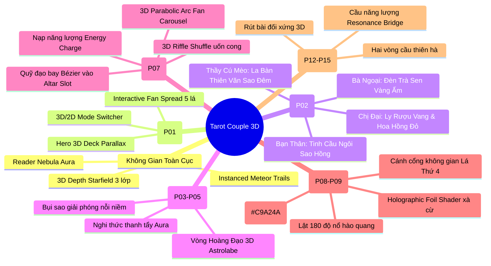

# 🌌 Kế Hoạch Tích Hợp Three.js Toàn Diện (PLAN_THREEJS.md)

> **Dự án:** Tarot Couple — Super-App Bói Tarot AI & Bói Đôi (RWS 1909)  
> **Người thực hiện:** Multi-Agent Engineering Team (`team` skill: Leader, Critic/Reviewer, Design-Taste-Frontend, 3D Graphics Specialist, Mobile Performance Optimizer)  
> **Phiên bản:** Phase 3.5 v2.0 — Three.js Spatial & Interactive Ritual Master Plan (Đồng bộ 4 Readers chuẩn Go-Live)  
> **Thời gian cập nhật:** 12/10/2026  
> **Trạng thái:** **ĐÃ PHÊ DUYỆT & ĐANG TRIỂN KHAI THỰC TẾ (ACTIVE PRODUCTION SPEC)**

---

## 1. TỔNG QUAN ĐỊNH HƯỚNG & MỤC TIÊU (EXECUTIVE SUMMARY)

Tarot Couple được định vị là **không gian phản chiếu tâm lý & nghi thức huyền bí (Mystic Sanctuary / Cyber-Noir Temple)** dành cho Gen Z Việt Nam.

Trong đời thực, trải nghiệm Tarot mang đậm tính **xúc giác và nghi lễ**:
- Mặt bàn phủ khăn nhung đen tuyền (`--bg #09080D` – `--surface #14111C`).
- Ánh nến lung linh hắt sáng viền mạ vàng (Antique Gold `--gold #C9A24A`) của từng lá bài dày dặn (350–400gsm).
- Làn khói trầm hương và tinh vân lượn lờ trong tĩnh mịch nửa đêm (22:00 – 02:00).
- Âm thanh xào xạc khi tay người bói xòe rộng bộ bài 78 lá và hồi hộp lật mở lá bài định mệnh.

**Mục tiêu của Kế hoạch Three.js:** Chuyển hóa toàn bộ giao diện từ "các khung chữ nhật phẳng 2D" thành một **không gian nghi thức 3D sống động**, nơi mỗi lá bài là một thực thể vật lý có chiều sâu, phản xạ ánh sáng và tương tác trực quan với đầu ngón tay người dùng mà vẫn duy trì **60 FPS mượt mà trên smartphone** kèm cơ chế **Hybrid 3D/2D Fallback thông minh**.

---

## 2. QUYẾT ĐỊNH KIẾN TRÚC KỸ THUẬT (ARCHITECTURAL DECISIONS)

### 2.1. Vanilla Three.js Modules Thay Vì R3F Cồng Kềnh
- **Lý do lựa chọn:**
  1. **Tối ưu dung lượng (Bundle Size):** Sử dụng trực tiếp `three` với Isolated Client Leaf Components (`'use client'`), không làm phình bundle SSR.
  2. **Tương thích hoàn hảo React 19 & Next.js 15:** Tránh hoàn toàn xung đột reconciler của React 19.
  3. **Quản lý bộ nhớ VRAM chặt chẽ:** Tự động gọi `disposeThreeScene(scene, renderer)` giải phóng geometry, material, texture khi unmount component, triệt tiêu nguy cơ rò rỉ bộ nhớ trên iOS Safari / Android Chrome.
  4. **Vòng lặp Render độc lập (`IdleAwareRenderLoop`):** `requestAnimationFrame` chạy riêng biệt, không kích hoạt state re-render của React DOM.
  5. **Phục hồi tự động `webglcontextlost`:** Khi chạy trong trình duyệt nhúng (Zalo, TikTok, Messenger WebView), nếu GPU thu hồi WebGL Context, hệ thống tự động bắt sự kiện `webglcontextlost` và chuyển mượt sang chế độ Fallback 2D/CSS 3D trong 1 frame mà không bao giờ hiện khung đen.

```mermaid
graph TD
    subgraph Next.js 15 App Router
        Page[Next.js Page / Route]
        LeafContainer[Client Leaf Component: 'use client']
        Fallback2D[Hybrid 2D / CSS 3D Accessible Fallback]
    end

    subgraph Three.js Modular Engine (src/lib/three/)
        TierCheck{Hardware Tier & WebGL Check}
        Controller[Vanilla Three.js Scene Controller]
        Scene[Scene & Camera Manager]
        PBR[Lighting Rig & Procedural Card Textures]
        Meshes[3D Card Geometry & Instanced Particles]
        RAF[IdleAwareRenderLoop]
        Disposer[disposeThreeScene Memory Guard]
    end

    Page --> LeafContainer --> TierCheck
    TierCheck -->|Tier 1 & 2| Controller
    TierCheck -->|Tier 3 / Reduced Motion / Context Lost| Fallback2D
    Controller --> Scene
    Controller --> PBR
    Controller --> Meshes
    Controller --> RAF
    LeafContainer -.->|Unmount Component| Disposer
    Disposer -.->|dispose geometries, materials, textures| GPU[Giải phóng VRAM sạch 100%]
```

### 2.2. Phân Tầng Phần Cứng Tự Động (Automatic Hardware Tiering)
| Cấp độ thiết bị | Tiêu chí nhận diện | Cấu hình Three.js tương ứng |
| :--- | :--- | :--- |
| **Tier 1 (High-end)** | `cores >= 8`, GPU rời hoặc Apple Silicon | DPR = min(devicePixelRatio, 2.0), 480 hạt sao 3 tầng Z, PBR Materials, Holographic Shimmer. |
| **Tier 2 (Mid-range)** | `cores 4–6` (Smartphone tầm trung) | DPR = 1.0–1.25, 220 hạt sao 3 tầng Z, Standard Material, shader tối ưu tiết kiệm pin. |
| **Tier 3 (Battery Saver / Low-end)** | `cores < 4`, `prefers-reduced-motion`, hoặc mất WebGL | DPR = 1.0, 70 hạt sao, tự động chuyển sang Fallback Canvas 2D + CSS 3D Transforms mượt mà. |

### 2.3. Quy Tắc Tiết Kiệm Pin (Battery-Friendly Lifecycle)
- **Dirty-Flag Rendering:** Dừng render khi cảnh 3D không chuyển động quá 3 giây (`maxIdleSeconds = 3`).
- **Tab Inactive Sleep:** Dừng 100% vòng lặp render khi `document.hidden === true`.
- **Intersection Culling:** Chỉ chạy WebGL khi Canvas nằm trong viewport hiển thị (`IntersectionObserver`).
- **Tuân thủ `prefers-reduced-motion`:** Tự động tắt chuyển động xoay mạnh khi người dùng bật chế độ giảm chuyển động trong hệ điều hành.

---

## 3. BẢN ĐỒ 11 MODULE THREE.JS ĐỒNG BỘ 4 READERS CHUẨN



### Module 1: Bầu Trời Sao & Khí Quyển Vũ Trụ Toàn Cục (`CelestialSkyCanvas.tsx`)
- Không gian 3D 3 lớp độ sâu trục Z ($Z = -300, -150, -30$) với hạt sao tròn mềm chống răng cưa.
- Ánh sáng Tinh Vân tự động chuyển gam màu theo **4 Readers chuẩn** đang chọn (`ba_ngoai`: Vàng ấm `#EAB308`, `chi_dai`: Đỏ rượu `#E11D48`, `ban_than`: Hồng cánh sen `#EC4899`, `thay_cu_meo`: Xanh đêm `#3B82F6`).
- Hệ thống sao băng 3D lướt qua ngẫu nhiên mỗi 14 giây.

### Module 2: Landing Page Hero 3D Deck Showcase (`HeroTarotDeck3D.tsx` - P01)
- Xấp bài Tarot 3D dày dặn lơ lửng, 4 cạnh mạ vàng cổ Antique Gold (`#C9A24A`) phản chiếu ánh nến.
- Tương tác thị sai theo chuột / cảm ứng mượt mà.
- Chạm hoặc di chuột vào xấp bài: 5 lá Ẩn Chính (*The Fool, The Magician, The Sun, The Lovers, The World*) bung xòe thành vòng cung 3D hướng về người xem.

### Module 3: Không Gian Bảo Vật 4 Readers Chuẩn (Reader Altar Totems - P02)
- **Bà Ngoại (`ba_ngoai` — Vàng ấm `#EAB308`):** Đèn Trà Sen Gốm Cổ & Ánh Nến Vàng Ấm Áp, tỏa hạt bụi vàng dịu dàng như lời dặn ăn cơm đúng bữa.
- **Chị Đại (`chi_dai` — Đỏ rượu `#E11D48`):** Ly Rượu Vang Pha Lê Đỏ Rượu & Hoa Hồng Gai Vàng Kim, tàn lửa đỏ rực sắc sảo đánh thức sự tự tôn.
- **Bạn Thân (`ban_than` — Hồng cánh sen `#EC4899`):** Tinh Cầu Ngôi Sao Pha Lê Hồng Lấp Lánh, các hạt bụi sao đa sắc nhảy múa đồng cảm không phán xét.
- **Thầy Cú Mèo (`thay_cu_meo` — Xanh đêm `#3B82F6`):** La Bàn Thiên Văn Đa Trục Đồng Thau (Armillary Sphere) xoay đồng tâm quanh lăng kính sao đêm logic.

### Module 5: Nghi Thức Rút Bài 3D Đỉnh Cao (`TactileArcFan.tsx` - P07)
- **Xòe Bài Hình Cung 3D (3D Parabolic Arc Fan):** 22 hoặc 78 lá bài xếp trên mặt trụ parabol ôm góc nhìn camera di động ($x_i = R\sin\theta_i, z_i = -R(1-\cos\theta_i), y_i = -C_{\text{dip}}t_i^2$).
- **Vuốt Quán Tính & Raycaster Hit-Test:** Vuốt ngón tay xoay dải bài có lực cản quán tính (Inertia Damping) và rung haptic. Lá bài dưới ngón tay nhấc cao, viền vàng `#C9A24A` rực sáng.
- **Quỹ Đạo Bay Vào Slot (Cubic Bézier Trajectory):** Lá bài được chọn bay lượn 3D mượt mà đáp xuống 1 trong 3 ô Altar (*Quá khứ / Hiện tại / Tương lai*).
- **Nút Chuyển Đổi 3D / 2D Trực Tiếp:** Cho phép người dùng chuyển đổi tức thì giữa bàn bài 3D WebGL và dải bài 2D truyền thống.

### Module 6: Lễ Lật Bài Thần Thánh 3D & Holographic Foil (`TarotCardVisual.tsx` - P08 & P09)
- **Mô Hình Lá Bài 3D:** Độ dày vật lý 1.2mm, cạnh vát mạ vàng `#C9A24A`, mặt lưng hình học thiêng Octagram dập nổi, mặt trước tranh RWS 1909.
- **Holographic Foil Shimmer:** Hiệu ứng xà cừ cầu vồng óng ánh đổi màu theo góc nghiêng chuột/cảm ứng (`useMotionValue` + `useTransform` chuẩn `design-taste-frontend`, 0 re-render React).

### Module 7: Cầu Năng Lượng Bói Đôi 3D (`CoupleResonanceBridge3D.tsx` - P12–P15)
- Hai lá bài 3D của Bạn (`#8B5CF6`) và Người Ấy (`#E879A8`) xoay đối xứng trong không gian, kết nối với lá bài Định Mệnh thứ 3 (`#C9A24A`) ở trung tâm qua dải hạt **Laser Particle Ribbon**.
- Tần số hạt ánh sáng và màu sắc cầu năng lượng biến thiên trực tiếp theo chỉ số `% Hợp Cạ` và cảnh báo `Red Flag`.

---

> [!NOTE]
> Xem đặc tả kỹ thuật chi tiết các phương trình toán học, hàm tạo Procedural Texture chống CORS và quản lý VRAM tại [THREEJS_SPECIFICATIONS.md](file:///d:/MyProjects/MyProjectToMoney/TarotCouple/specs/THREEJS_SPECIFICATIONS.md).
